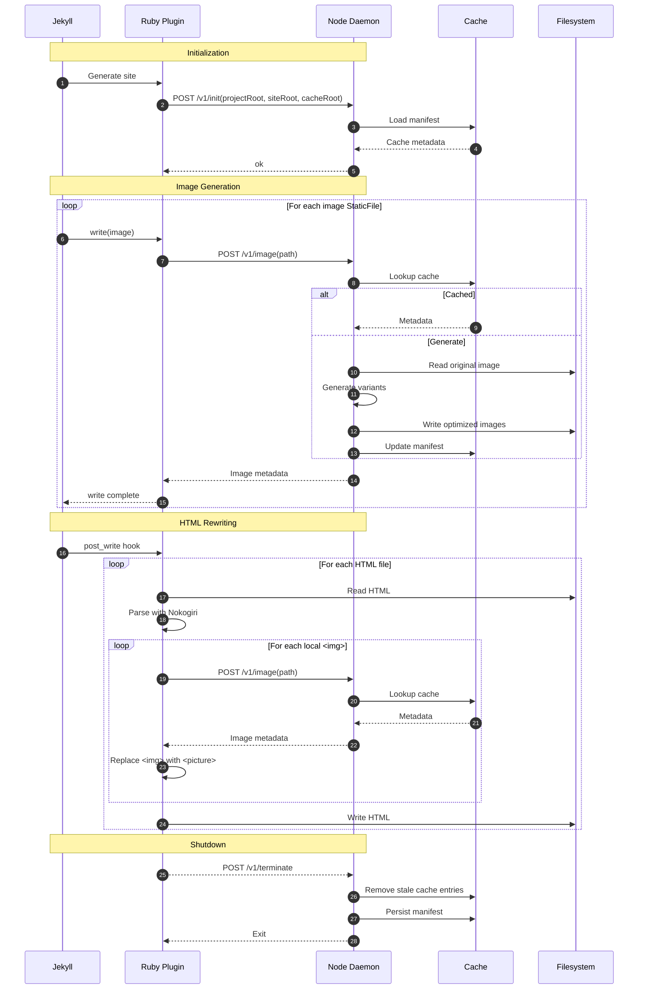

# Image Pipeline

A hybrid image optimization pipeline for Jekyll.

The project is split into two independent components:

- **Daemon** (Node.js) — performs all image processing using modern image libraries such as Sharp and SVGO.
- **Jekyll Plugin** (Ruby) — integrates with Jekyll, communicates with the daemon, and rewrites generated HTML into responsive `<picture>` markup.

The two components communicate exclusively through a small versioned JSON protocol over stdin/stdout.

## Goals

- Zero changes required to Markdown authoring.
- Incremental Jekyll builds.
- Process each image only once.
- Cache generated variants.
- Generate responsive images (`srcset` + `<picture>`).
- Preserve a clean separation between image processing and Jekyll integration.
- Keep the daemon reusable outside Jekyll.

## Architecture



## Directory Layout

```text
image-pipeline/
├── README.md
├── protocol/
│
├── daemon/
│   ├── src/
│   ├── dist/
│   └── package.json
│
└── jekyll_plugin/
    ├── image_pipeline.gemspec
    ├── Gemfile
    └── lib/
```
